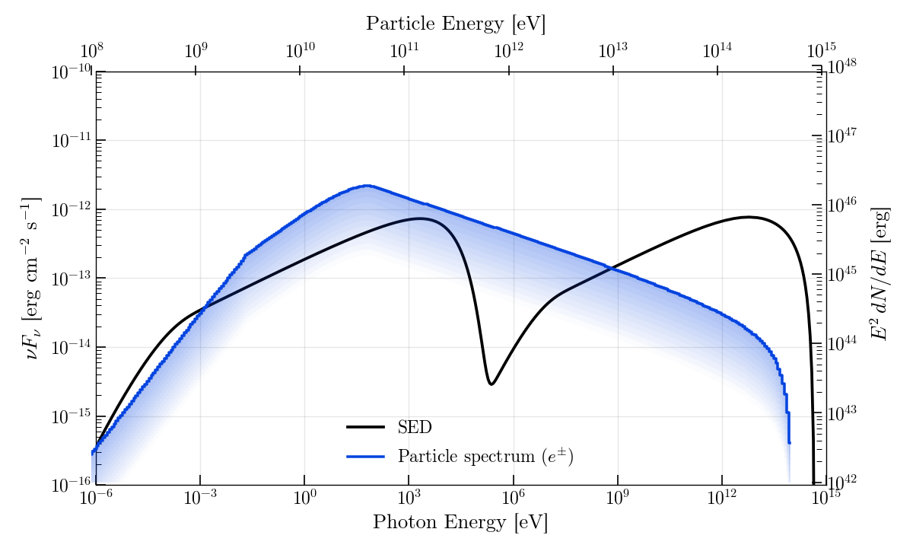
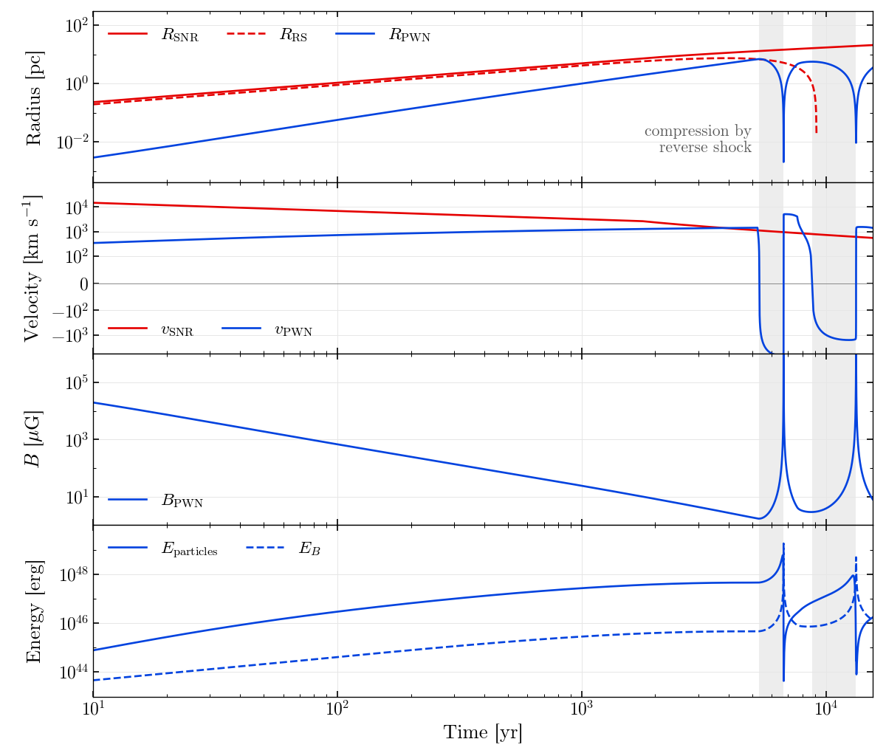

# VIPER - Volume-Integrated PWN Evolution & Radiation

[](https://pypi.org/project/viper-pwn/)
[](https://pypi.org/project/viper-pwn/)
[](https://viper-pwn.readthedocs.io/en/latest/)
[](LICENSE)
[](https://doi.org/10.5281/zenodo.23984295)

A Python implementation of the **Gelfand, Slane & Zhang (2009)** model
of a pulsar wind nebula (PWN) evolving inside its supernova remnant.

VIPER follows the PWN radius, magnetic field, and particle spectrum
through time and computes the broadband photon spectrum from radio to
gamma rays, so a model can be fit to the measured size and spectral
energy distribution (SED) of a source.

## Installation

```bash
pip install viper-pwn
```

Requires Python >= 3.10 (NumPy, SciPy, and Astropy are installed
automatically).  Optional: Numba (fast kernels), emcee and h5py (MCMC
fitting), UltraNest (nested sampling), matplotlib and corner (plots),
gammapy.

Development install, with [uv](https://docs.astral.sh/uv/):

```bash
git clone https://github.com/j-alford/viper-pwn
cd viper-pwn
uv venv && source .venv/bin/activate
uv pip install -e ".[fast]"
```

## Quick Start

Set up a model, run it, and read off the final state:

```python
import astropy.units as u
from viper import PWNModel

model = PWNModel()
model.set_pulsar('J0007+7303')         # P, Pdot, and distance from the ATNF catalogue
model.distance.value = 1.4 * u.kpc     # override the catalogue distance

model.esn.value = 1e51 * u.erg         # supernova energy
model.mej.value = 6 * u.M_sun          # ejecta mass
model.n_ism.value = 0.4 / u.cm**3      # ambient density
model.tau_sd.value = 3000 * u.yr       # spin-down time (with P, Pdot, and n, sets the age)
model.eta_b.value = 0.01               # fraction of spin-down power in magnetic field
model.e_max.value = 500 * u.TeV        # maximum injected particle energy

result = model.run()

final = result.dyninfo[-1]
print(f"age   = {final.time:.0f} yr")
print(f"R_pwn = {final.rad_pwn:.2f} pc")
print(f"B     = {final.bpwn:.2f} uG")
```

Every parameter is an attribute with a value, bounds, and a frozen
flag; `print(model.parameters)` lists them all.  The ones not set
above (braking index, injection spectrum `e_min`, `e_break`, `p1`,
`p2`) keep their defaults.  Extra photon fields for inverse-Compton
scattering are added with `model.add_ic_field(temp=..., norm=...)`,
where `norm` is the energy density in eV/cm^3; the CMB is always
included.

### SED and Particle Spectrum

Plot the photon spectrum and the particle spectrum that produces it:

```python
import matplotlib.pyplot as plt
from viper.plotting import plot_model_sed

fig, _ = plot_model_sed(result, distance=model.distance.value)
plt.show()
```



### Evolution History

VIPER records how the nebula and its supernova remnant evolved up to
the present age, and saves the dynamical quantities at each timestep
to `result.dyninfo`.  The figure below shows this history for the
model above.



## Fitting a Source

A fit is described by one Python file: the pulsar, the observations,
the parameters to fit (start value and bounds), the parameters held
fixed, and any priors.  [`examples/g54.py`](examples/g54.py) is a
complete example for G54.1+0.3; in outline:

```python
import astropy.units as u
from viper import Observable

PULSAR = 'J1930+1852'

OBSERVABLES = [
    Observable.angular_size_pwn(1.14, 0.04, 'arcmin'),
    Observable.flux_density(1.4, 'GHz', 433, 30, 'mJy'),
    Observable.band_flux(2, 10, 'keV', 5.43e-12, 0.035e-12),
    Observable.spectral_index(2, 10, 'keV', 2.09, 0.01),
    Observable.flux_density(311, 'GeV', 1.10e-11, 0.56e-11, 'photons/cm2/s/TeV'),
]

PARAMETERS = {                                # start, lower bound, upper bound
    'mej':    (21 * u.M_sun, 1 * u.M_sun, 100 * u.M_sun),
    'tau_sd': (3574 * u.yr,  100 * u.yr,  1e5 * u.yr),
    'eta_b':  (0.0024,       1e-5,        0.5),
}

FROZEN = {'esn': 0.95e51 * u.erg, 'braking_index': 1.9, 'p1': 2.29, 'p2': 2.42}

PRIORS = {'distance': (6.2 * u.kpc, 1.0 * u.kpc)}   # Gaussian: centre, sigma

IC_FIELDS = [{'temp': 2753 * u.K, 'norm': 23.6 * u.eV / u.cm**3}]

FIT = {'nwalkers': 32, 'nsteps': 2000}
```

Run it with the MCMC runner (emcee) or the nested-sampling runner
(UltraNest), and watch the chain:

```bash
python3 tools/run_mcmc.py my_source.py --ncores 8
python3 tools/run_nested.py my_source.py --ncores 4
python3 tools/monitor.py results/my_source_run01/chain.h5
```

Each run gets its own folder under `results/` with the chain, the best
fit, and a copy of the source file as it was at launch.  Observables
take their units as strings (Hz/GHz, eV/keV/TeV, Jy/mJy, erg/s/cm2,
photons/cm2/s/TeV, arcmin/arcsec), a `weight=`, and `upper_limit=True`
for limits.  The full file format and runner options are in
[Fit a source](https://viper-pwn.readthedocs.io/en/latest/getting-started/fit-a-source.html).

The same machinery is available in Python, for notebooks or custom
scripts.  Load a source file, or configure the model directly:

```python
import astropy.units as u
from viper import PWNModel, Observable, run_mcmc, load_source, build_from_source

# from a source file
model, observables, spec = build_from_source(load_source('my_source.py'))

# or by hand: a parameter is fit once it is unfrozen and has bounds
model = PWNModel()
model.set_pulsar('J1930+1852')
model.mej.value  = 21 * u.M_sun
model.mej.bounds = (1 * u.M_sun, 100 * u.M_sun)
model.mej.frozen = False
observables = [Observable.flux_density(1.4, 'GHz', 433, 30, 'mJy')]

sampler, spec = run_mcmc(model, observables, nwalkers=32, nsteps=2000, n_cores=8)
```

## Physics

- **SNR dynamics**: Truelove & McKee (1999) solution for a
  non-radiative remnant with a power-law ejecta envelope.
- **PWN dynamics**: pressure-driven expansion into the ejecta; after
  the collision with the reverse shock the nebula is compressed and
  re-expands, following the Bandiera (1984) interior pressure.
- **Particles**: broken power-law injection (log-parabola and
  cutoff power-law optional), adiabatic, synchrotron, and
  inverse-Compton losses with the full Klein-Nishina cross-section.
- **Radiation**: synchrotron and inverse-Compton emission on the CMB
  plus any number of additional photon fields; synchrotron
  self-Compton and particle escape are optional.
- **One zone**: no spatial structure within the PWN.

## Gammapy

`PWNSpectralModel` wraps the model as a gammapy `SpectralModel`, so it
can be fit with gammapy's datasets and `Fit`:

```python
import astropy.units as u
from viper.gammapy import PWNSpectralModel

model = PWNSpectralModel(
    period=0.136, p_dot=7.5112e-13,
    esn=0.95, mej=21.0, n_ism=0.008, distance=6223.0,
    braking_index=1.9, tau_sd=3574.0, eta_b=0.0024,
    e_min=10.0, e_max=4e5, e_break=3232.0, p1=2.29, p2=2.42,
    ic_temp_1=2753.0, ic_norm_1=23.6137,     # ic_norm_1 in eV/cm^3
)
model.distance.frozen = True
model.plot(energy_bounds=[1e-7, 100] * u.TeV)
```

`PWNSpectralModel.for_cta1()` and `.for_g54()` are preconfigured
examples.  Results are cached, so repeated evaluations at unchanged
parameters (as in gammapy's numerical integration) are free.

## References

The model:

- Gelfand, J. D., Slane, P. O., & Zhang, W. 2009, ApJ, 703, 2051.
  [doi:10.1088/0004-637X/703/2/2051](https://doi.org/10.1088/0004-637X/703/2/2051)
- Truelove, J. K., & McKee, C. F. 1999, ApJS, 120, 299.
  [doi:10.1086/313176](https://doi.org/10.1086/313176)

Applications of the model to individual nebulae:

- Brunelli, G., Mori, K., Park, J., et al. 2026, ApJ, 998, 230 (G0.9+0.1).
  [doi:10.3847/1538-4357/ae38e0](https://doi.org/10.3847/1538-4357/ae38e0)
- Abdelmaguid, M., Gelfand, J. D., & Alford, J. A. J. 2025, ApJ, 992, 1 (HESS J1640-465).
  [doi:10.3847/1538-4357/adfec1](https://doi.org/10.3847/1538-4357/adfec1)
- Alford, J. A. J., Zhang, G.-B., & Gelfand, J. D. 2025, ApJ, 987, 63 (G54.1+0.3).
  [doi:10.3847/1538-4357/add92e](https://doi.org/10.3847/1538-4357/add92e)
- Pope, I., Mori, K., Abdelmaguid, M., et al. 2024, ApJ, 960, 75 (Boomerang).
  [doi:10.3847/1538-4357/ad0120](https://doi.org/10.3847/1538-4357/ad0120)
- Woo, J., An, H., Gelfand, J. D., et al. 2023, ApJ, 954, 9 (Dragonfly).
  [doi:10.3847/1538-4357/acdd5e](https://doi.org/10.3847/1538-4357/acdd5e)
- Abdelmaguid, M., Gelfand, J. D., Gotthelf, E., & Straal, S. 2023, ApJ, 946, 40 (HESS J1640-465).
  [doi:10.3847/1538-4357/acbd30](https://doi.org/10.3847/1538-4357/acbd30)
- Eagle, J., Castro, D., Mahhov, P., et al. 2023, ApJ, 945, 4 (B0453-685).
  [doi:10.3847/1538-4357/acb8b1](https://doi.org/10.3847/1538-4357/acb8b1)
- Straal, S. M., Gelfand, J. D., & Eagle, J. L. 2023, ApJ, 942, 103 (Kes 75).
  [doi:10.3847/1538-4357/aca1a9](https://doi.org/10.3847/1538-4357/aca1a9)
- Burgess, D. A., Mori, K., Gelfand, J. D., et al. 2022, ApJ, 930, 148 (Eel).
  [doi:10.3847/1538-4357/ac650a](https://doi.org/10.3847/1538-4357/ac650a)
- Gotthelf, E. V., Safi-Harb, S., Straal, S. M., & Gelfand, J. D. 2021, ApJ, 908, 212 (Kes 75).
  [doi:10.3847/1538-4357/abd32b](https://doi.org/10.3847/1538-4357/abd32b)
- Hattori, S., Straal, S. M., Zhang, E., et al. 2020, ApJ, 904, 32 (G21.5-0.9).
  [doi:10.3847/1538-4357/abba32](https://doi.org/10.3847/1538-4357/abba32)
- Temim, T., Slane, P., Kolb, C., et al. 2015, ApJ, 808, 100 (G327.1-1.1).
  [doi:10.1088/0004-637X/808/1/100](https://doi.org/10.1088/0004-637X/808/1/100)
- Gelfand, J. D., Slane, P. O., & Temim, T. 2015, ApJ, 807, 30 (G54.1+0.3).
  [doi:10.1088/0004-637X/807/1/30](https://doi.org/10.1088/0004-637X/807/1/30)
