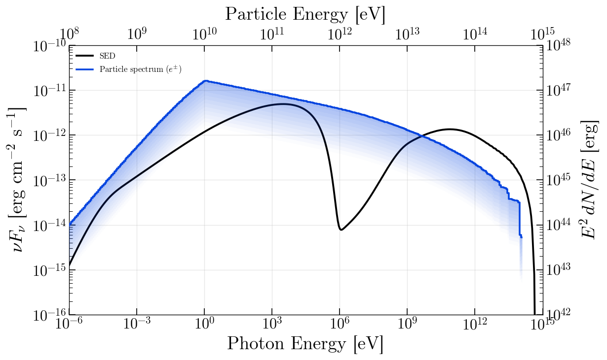
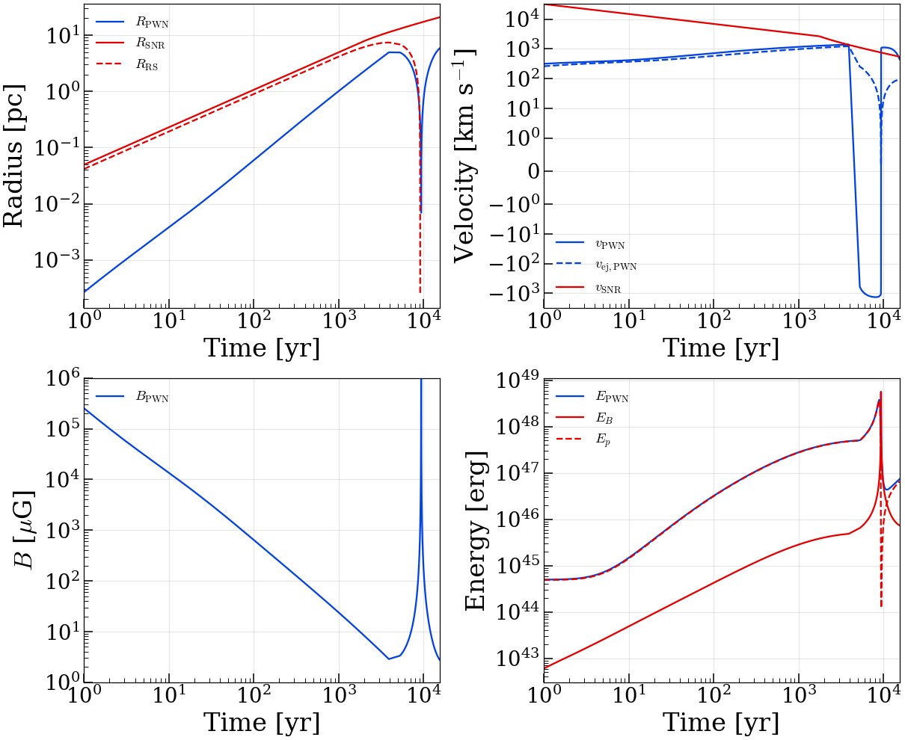

# VIPER - Volume-Integrated PWN Evolution & Radiation

A Python implementation of the semi-analytic PWN model described in
**Gelfand, Slane & Zhang (2009), ApJ 703, 2051**.

This code evolves a pulsar wind nebula inside a supernova
remnant, tracking the PWN radius, magnetic field, particle energy
spectrum, and broadband photon emission from radio through gamma-rays.

## Installation

**Requirements**: Python >= 3.10, NumPy >= 1.21, SciPy >= 1.7, Astropy >= 5.0

**Optional**: Numba >= 0.57, emcee >= 3.0, corner, gammapy >= 2.0, matplotlib >= 3.5

```bash
pip install viper-pwn
```

Or for a development install (with [uv](https://docs.astral.sh/uv/);
install via `curl -LsSf https://astral.sh/uv/install.sh | sh`):

```bash
git clone https://github.com/j-alford/viper-pwn
cd viper-pwn
uv venv && source .venv/bin/activate
uv pip install -e ".[fast]"
```

## Quick Start

```python
import astropy.units as u
from viper import PWNModel

model = PWNModel()
model.set_pulsar('J0007+7303')           # loads P, Pdot, distance from ATNF catalog
model.distance.value = 1.4 * u.kpc       # override the ATNF catalog value if desired

model.esn.value = 1e51 * u.erg
model.mej.value = 6.0 * u.M_sun
model.n_ism.value = 0.4 / u.cm**3
model.braking_index.value = 2.5
model.tau_sd.value = 3000 * u.yr
model.eta_b.value = 0.01
model.e_min.value = 3.0 * u.GeV
model.e_max.value = 500 * u.TeV
model.e_break.value = 50.0 * u.GeV
model.p1.value = 0.8
model.p2.value = 2.5

# model.add_ic_field(temp=2753, norm=23.6137)   # optional: add a NIR seed field (norm in eV/cm^3)

result = model.run()

dyn = result.dyninfo[-1]
print(f"R_pwn = {dyn.rad_pwn:.2f} pc")
print(f"B     = {dyn.bpwn:.2f} uG")
print(f"V_pwn = {dyn.vpwn:.0f} km/s")
```

### Plotting the SED and Particle Spectrum

```python
import matplotlib.pyplot as plt
from viper.plotting import plot_model_sed

fig, _ = plot_model_sed(result, distance=model.distance.value)
plt.show()
```



### Evolution history

`result.dyninfo` records the full dynamical history at every timestep:
radii (`rad_pwn`, `rad_snr`, `rad_rs`, `rad_psr`), velocities (`vpwn`,
`vejpwn`, `vsnr`), magnetic field (`bpwn`), energies (`epwn_50`,
`epwnb_50`, `epwnp_50` in units of 10^50 erg), luminosities
(`synch_lum_40`, `ic_lum_40`, `ad_lum_40`, `edot_40` in 10^40 erg/s),
pressures (`ppwn`, `psnrpwn`), PWN-swept ejecta mass (`mswpwn`).



Reproducer: [`docs/scripts/make_evolution_grid.py`](docs/scripts/make_evolution_grid.py).

## Physics Notes

- **SNR dynamics**: Truelove & McKee (1999) analytic solution for
  non-radiative SNR with power-law ejecta profile (n=9 hardcoded).
- **PWN-RS collision**: Detected when R_pwn > R_rs; switches to
  Bandiera (1984) self-similar interior pressure.
- **Radiative losses**: Synchrotron + IC (full Klein-Nishina cross-section).
  Adiabatic losses from PWN expansion included.
- **IC target fields**: the CMB is always included, and the model
  supports including additional photon fields.
- **Single-zone**: No spatial structure within the PWN.
- **SSC**: Synchrotron self-Compton is off by default.

## MCMC Fitting with emcee

The `fitting` module provides a complete MCMC pipeline using
[emcee](https://emcee.readthedocs.io). Set up a model, unfreeze
parameters with bounds, and pass observables in whatever units your
data are in:

```python
import astropy.units as u
from viper import PWNModel
from viper.fitting import run_mcmc
from viper.observables import Observable

model = PWNModel()
model.set_pulsar('J1930+1852')

model.esn.value = 0.95e51 * u.erg
model.esn.frozen = False
model.esn.bounds = (1e49 * u.erg, 3e51 * u.erg)

model.mej.value = 21 * u.M_sun
model.mej.frozen = False
model.mej.bounds = (1 * u.M_sun, 100 * u.M_sun)

model.n_ism.value = 0.008 / u.cm**3
model.n_ism.frozen = False
model.n_ism.bounds = (1e-4 / u.cm**3, 1 / u.cm**3)

# ... set bounds for all free params ...

model.add_ic_field(temp=2753, norm=23.6137, frozen=False)  # norm in eV/cm^3
model.parameters['ic_temp_1'].bounds = (1000 * u.K, 5000 * u.K)
model.parameters['ic_norm_1'].bounds = (1.0, 100.0)         # eV/cm^3

observables = [
    Observable.angular_size_snr(6.6, 0.4, 'arcmin'),
    Observable.angular_size_pwn(1.14, 0.04, 'arcmin'),
    Observable.flux_density(1.4, 'GHz', 433, 30, 'mJy'),
    Observable.flux_density(4.7, 'GHz', 327, 25, 'mJy'),
    Observable.band_flux(2, 10, 'keV', 5.43e-12, 0.035e-12),
    Observable.spectral_index(2, 10, 'keV', 2.09, 0.01),
    Observable.flux_density(311, 'GeV', 1.10e-11, 0.56e-11,
                            'photons/cm2/s/TeV'),
]

sampler, spec = run_mcmc(model, observables, nwalkers=32, nsteps=5000, n_cores=12)
```

Observable types: `angular_size_snr`, `angular_size_pwn`, `flux_density`
(at any frequency/energy), `band_flux` (integrated), `spectral_index`.
Supports units: Hz/GHz/MHz, eV/keV/MeV/GeV/TeV, Jy/mJy,
erg/s/cm2/Hz, photons/cm2/s/TeV, erg/s/cm2, arcmin/arcsec/deg.

## Gammapy Integration

VIPER includes the class `PWNSpectralModel`, which can be used
directly in [gammapy](https://gammapy.org):

```python
from viper.gammapy import PWNSpectralModel
import astropy.units as u

# Pre-configured for CTA 1
model = PWNSpectralModel.for_cta1()
print(model)

# Plot
model.plot(energy_bounds=[1e-7, 100] * u.TeV)

# Or for G54.1+0.3 (with NIR IC field)
model = PWNSpectralModel.for_g54()

# Custom source
model = PWNSpectralModel(
    period=0.136, p_dot=7.5112e-13,
    esn=0.95, mej=21.0, n_ism=0.008, distance=6223.0,
    braking_index=1.9, tau_sd=3574.0, eta_b=0.0024,
    e_min=10.0, e_max=4e5, e_break=3232.0,
    p1=2.29, p2=2.42,
    ic_temp_1=2753.0, ic_norm_1=23.6137,   # ic_norm_1 in eV/cm^3
)

# Freeze/thaw parameters for fitting
model.distance.frozen = True
model.braking_index.frozen = True
```

The model caches results so repeated `evaluate` calls with unchanged
parameters (e.g., during gammapy's numerical integration) are instant.

## References

- Gelfand, J. D., Slane, P. O., & Zhang, W. 2009, ApJ, 703, 2051.
  [doi:10.1088/0004-637X/703/2/2051](https://doi.org/10.1088/0004-637X/703/2/2051)

- Truelove, J. K. & McKee, C. F. 1999, ApJS, 120, 299.
  [doi:10.1086/313176](https://doi.org/10.1086/313176)

The Gelfand et al. (2009) model has been applied to constrain the
properties of numerous PWNe. Recent applications include:

- Gelfand, J. D., Slane, P. O., & Temim, T. 2015, ApJ, 807, 30.
  [doi:10.1088/0004-637X/807/1/30](https://doi.org/10.1088/0004-637X/807/1/30)

- Alford, J. A. J., Zhang, G.-B., & Gelfand, J. D. 2025, ApJ, 987, 63.
  [doi:10.3847/1538-4357/add92e](https://doi.org/10.3847/1538-4357/add92e)
