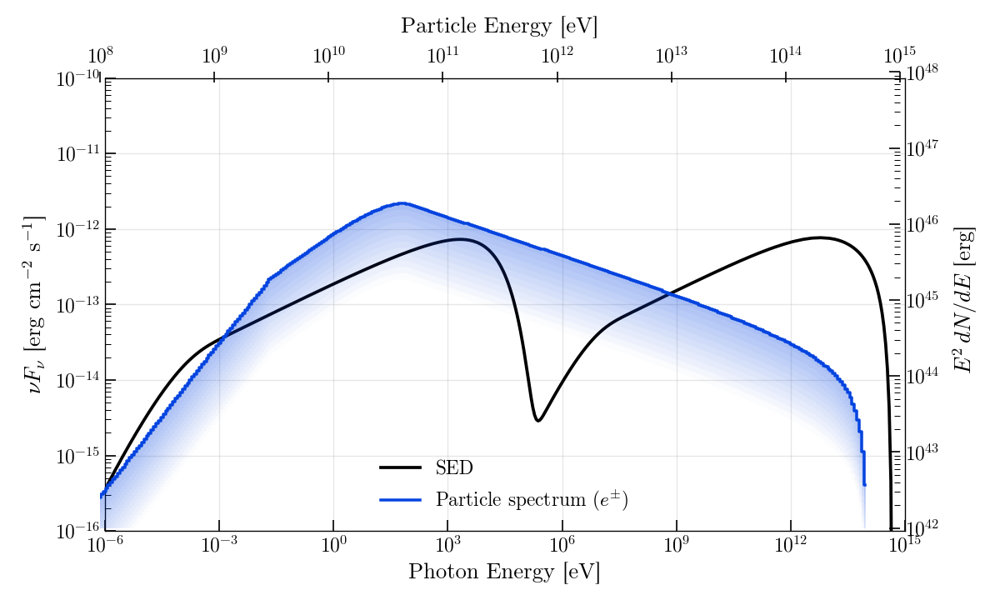
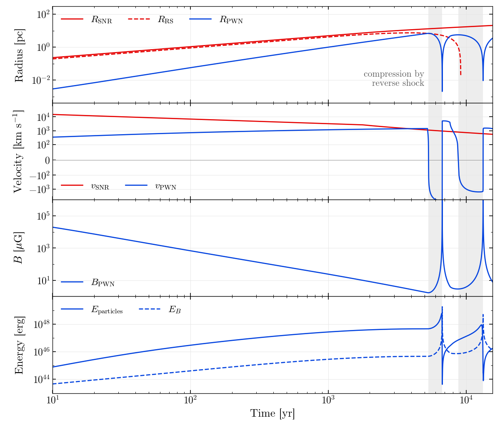

# Quick Start

Set up a model, run it, and read off the final state:

```python
import astropy.units as u
from viper import PWNModel

model = PWNModel()
model.set_pulsar('J0007+7303')         # P, Pdot, and distance from the ATNF catalogue
model.distance.value = 1.4 * u.kpc     # override the catalogue distance

model.esn.value = 1e51 * u.erg         # supernova energy
model.mej.value = 6 * u.M_sun          # ejecta mass
model.n_ism.value = 0.4 / u.cm**3      # ambient density
model.tau_sd.value = 3000 * u.yr       # spin-down time (with P, Pdot, and n, sets the age)
model.eta_b.value = 0.01               # fraction of spin-down power in magnetic field
model.e_max.value = 500 * u.TeV        # maximum injected particle energy

result = model.run()

final = result.dyninfo[-1]
print(f"age   = {final.time:.0f} yr")
print(f"R_pwn = {final.rad_pwn:.2f} pc")
print(f"B     = {final.bpwn:.2f} uG")
```

Every parameter is an attribute with a value, bounds, and a frozen
flag; `print(model.parameters)` lists them all.  The ones not set
above (braking index, injection spectrum `e_min`, `e_break`, `p1`,
`p2`) keep their defaults.  Extra photon fields for inverse-Compton
scattering are added with `model.add_ic_field(temp=..., norm=...)`,
where `norm` is the energy density in eV/cm^3; the CMB is always
included.

## SED and Particle Spectrum

Plot the photon spectrum and the particle spectrum that produces it:

```python
import matplotlib.pyplot as plt
from viper.plotting import plot_model_sed

fig, _ = plot_model_sed(result, distance=model.distance.value)
plt.show()
```



## Evolution History

VIPER records how the nebula and its supernova remnant evolved up to
the present age, and saves the dynamical quantities at each timestep
to `result.dyninfo`.  The figure below shows this history for the
model above.



Each entry of `result.dyninfo` has these fields:

| Quantity | Fields | Unit |
|---|---|---|
| Time | `time` | yr |
| Radii: nebula, remnant, reverse shock, pulsar offset | `rad_pwn`, `rad_snr`, `rad_rs`, `rad_psr` | pc |
| Velocities: nebula, ejecta at the nebula, remnant | `vpwn`, `vejpwn`, `vsnr` | km/s |
| Magnetic field | `bpwn` | µG |
| Energies: total, magnetic, particles | `epwn_50`, `epwnb_50`, `epwnp_50` | 10^50 erg |
| Luminosities: synchrotron, inverse Compton, adiabatic, spin-down | `synch_lum_40`, `ic_lum_40`, `ad_lum_40`, `edot_40` | 10^40 erg/s |
| Pressures: nebula, remnant at the nebula | `ppwn`, `psnrpwn` | dyn/cm^2 |
| Ejecta mass swept up by the nebula | `mswpwn` | M_sun |
